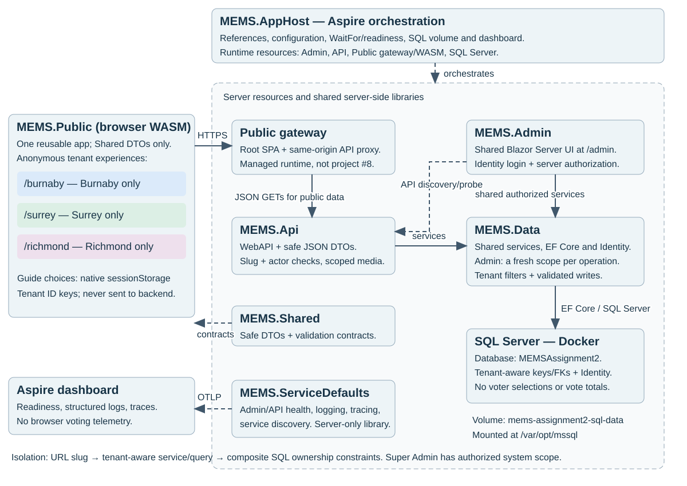
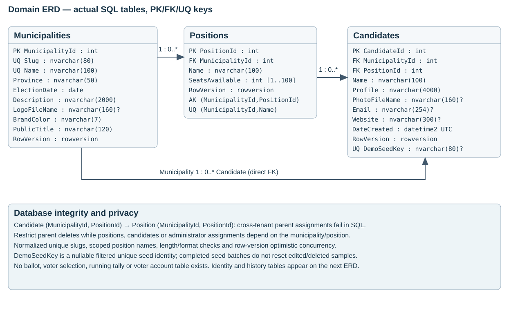
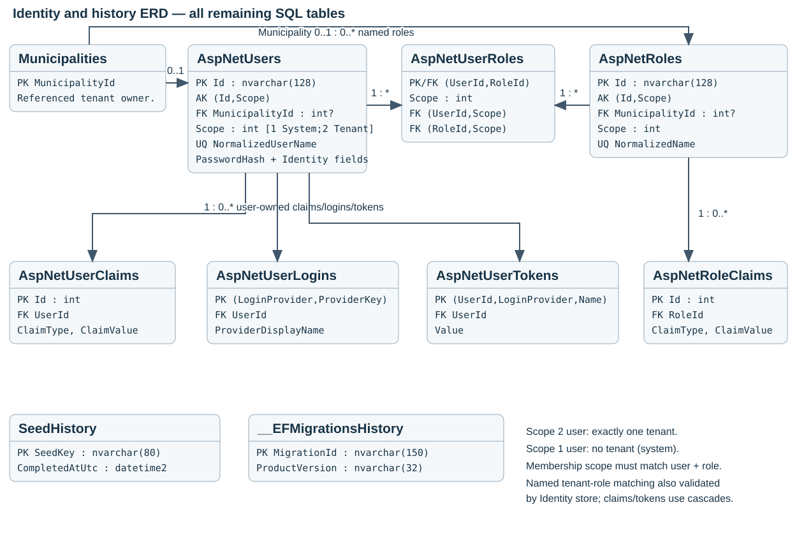

# System architecture and tenant isolation

The solution contains exactly seven .NET 10 projects: AppHost, ServiceDefaults, Admin, Public, Api, Data and Shared. The AppHost orchestrates Blazor Server Admin, the Public WASM gateway/client, Web API and SQL Server, with resource references, readiness and observability. The gateway is an Aspire-managed file-based runtime, not an eighth solution project. SQL uses the retained named container and persistent volume; no Azure deployment is required.

Admin runs at `/admin` and calls the shared authorized Data services with a fresh scope/context per operation; it also retains an Aspire-discovered API connectivity probe. API uses those same services behind controllers, safe DTOs and policy checks. Public references Shared only and uses anonymous same-origin API/media requests through the gateway; it has no SQL/EF/Identity/server ServiceDefaults dependency.

Burnaby, Surrey and Richmond are experiences of one reusable WASM application, not separate projects. Their URL slugs resolve municipality IDs. Public queries are scoped to that municipality; administrators' stored Identity scope/assignment governs reads and writes independently of route/body IDs. Super Admin is authorized for system scope; municipal administrators have exactly one tenant. Unknown slugs/foreign record IDs fail safely, and SQL composite candidate/position ownership prevents cross-tenant parent assignments even below the UI.

Shared server ServiceDefaults provide health/discovery/logging/tracing; gateway instrumentation remains server-side and WASM choice telemetry is disabled. Secrets/keys/uploads remain outside the public graph under ignored local storage. Voting-guide choices use municipality-specific native Session Storage and selection-independent public catalog queries; they never enter APIs, URLs, server sessions, logs, SQL or Admin screens.

The ERDs cover all 12 actual SQL tables. PK identifies a primary key; FK a foreign key; UQ a unique index; AK an alternate/principal key; `?` a nullable field. Domain parents restrict deletion while referenced. Identity memberships enforce matching user/role scope; claims/logins/tokens retain normal owned cascades. Row versions implement optimistic concurrency. The data dictionary is generated from read-only live SQL metadata and contains schema information only, never stored password hashes or keys.

