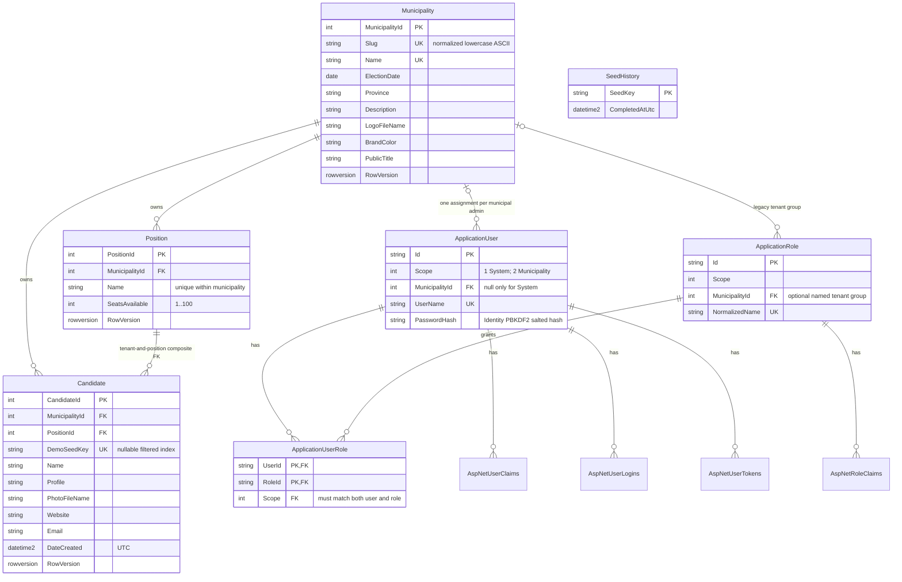

# Phase 2 SQL Server schema

Exactly seven solution projects are retained. This is the data/Identity foundation; HTTP tenant authorization and UI features remain for later phases.

`SeedHistory(SeedKey PK, CompletedAtUtc)` independently records completed seed batches. `__EFMigrationsHistory` records migration versions. There are no ballots, selection records, vote totals, or voter accounts.

SQL tables: Municipalities, Positions, Candidates, SeedHistory, AspNetUsers, AspNetRoles, AspNetUserRoles, AspNetUserClaims, AspNetRoleClaims, AspNetUserLogins, AspNetUserTokens, and __EFMigrationsHistory (12 total).

Candidate `(MunicipalityId, PositionId)` references Position `(MunicipalityId, PositionId)`, backed by a Position alternate key. A foreign-tenant position therefore cannot be assigned even using direct SQL. Parent deletion is restricted for domain records and administrator assignments. Identity claims/logins/tokens retain their normal ownership cascades; membership links restrict deletion until removed explicitly.

Municipal administrators have one non-null MunicipalityId; System administrators have none. SQL check constraints enforce this distinction. Membership composite foreign keys `(UserId, Scope)` and `(RoleId, Scope)` prevent a municipality-scoped account from receiving the System role. Named legacy tenant groups are additionally checked by the Identity store; the canonical tenant assignment on ApplicationUser must remain the source of authorization, never the group label alone.

Other safeguards: normalized/reserved slug constraints, unique municipality names, per-tenant office names, seat limits, required/length constraints, HTTP(S) websites, basic email constraints, safe stored filenames, and optimistic row versions. Complete email/URL validation is also performed through DataAnnotations; SQL email checks deliberately provide only basic structural integrity.

MemsDbContext defaults to no domain access until assigned a tenant. TenantElectionReader creates a context per operation, applies tenant query filters, and rejects cross-tenant direct candidate IDs. Tenant writes validate current/original ownership. Tenant IDs are also concurrency predicates on positions/candidates. Only internal initialization can enable System scope today. The narrow slug-directory query deliberately bypasses filters and returns only a TenantSummary. Phase 3 must authorize the principal before establishing a tenant or privileged scope; these services alone do not constitute completed API authorization.

Migrations applied, in order:

1. `20261116003601_InitialSqlServerIdentityTenancy`: fresh SQL Server/Identity schema with bounded composite Identity keys. Reviewed Up contains no data deletion, table drops or SQLite definitions.
2. `20261116004505_FixHyphenatedSlugsAndAssetNames`: corrects SQL LIKE hyphen placement in three check constraints. It replaces constraints only, retaining tables and records.

Both migrations run before the seed on a fresh empty Assignment 2 database. No migration rollback, database reset, volume removal, or SQLite import is required. The initial seed failure caused by the hyphen expression rolled back atomically; no partial sample records survived.

This ERD should be updated as later phases add verified schema changes and embedded in the final assignment report, addressing the reported Assignment 1 ERD omission.
